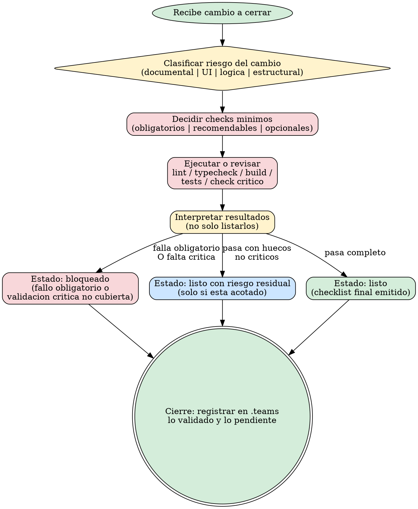

# Validar Calidad

# Objetivo

Convertir el cierre tecnico de una tarea en un proceso sistematico, proporcional al riesgo y defendible.

La skill decide que validaciones minimas son razonables para un cambio concreto, ejecuta o revisa las comprobaciones relevantes, detecta gaps y regresiones obvias, y deja un estado final claro antes de considerar el trabajo listo.

La accion dominante es **emitir un estado final honesto (`listo`, `bloqueado` o `listo con riesgo residual`) basado en evidencia real, no en impresiones**.

# Anti-patrones y su correccion

Cada sesgo fuerte del entrenamiento base necesita su par MAL -> BIEN -> EJEMPLO.

- **Dogma uniforme:** MAL aplicar los mismos checks pesados a un fix de typo y a un cambio de RLS. BIEN escalar la validacion con el riesgo real del cambio. EJEMPLO cambio solo documental -> validacion ligera; cambio de logica de negocio -> typecheck + build + tests + check del comportamiento afectado.
- **Checks inventados:** MAL inventar comandos que no existen en el proyecto para "cumplir" el gate. BIEN usar `docs/SSOT.md`, estrategia de testing y scripts reales detectados. EJEMPLO si no hay `npm test`, no lo invocas; buscas el comando real o escalas el hueco.
- **Maquillar fallos:** MAL declarar `listo` con una validacion critica fallida o no cubierta. BIEN el estado final es `bloqueado` (fallo obligatorio) o `listo con riesgo residual` solo si el hueco esta acotado y es de bajo riesgo. EJEMPLO typecheck rojo -> `bloqueado`, nunca `listo con riesgo residual`.
- **Solo listar sin interpretar:** MAL pegar el output crudo de lint/build sin decir que significa. BIEN interpretar los resultados y concluir el estado. EJEMPLO "build OK, typecheck OK, 1 test falla en auth -> bloqueado por check critico", no solo "npm run test: 1 failing".
- **Loops infinitos de checks:** MAL pedir mas validaciones indefinidamente por ansiedad. BIEN ampliar la validacion solo ante una sospecha concreta, una validacion critica no cubierta o un fallo que haya que acotar. EJEMPLO tras validar lo proporcional al riesgo, cerrar; no anadir un decimo check "por si acaso".
- **Opcional elevado a bloqueo:** MAL bloquear el cierre por un check opcional sin evidencia de riesgo material. BIEN un check opcional no bloquea salvo que durante la revision aparezca evidencia concreta de riesgo. EJEMPLO cobertura de un modulo no tocado es opcional; solo bloquea si el diff revela regresion ahi.
- **Gate heredado:** MAL cerrar con un verde anterior a un cambio de fuente, configuracion, dependencia o sonda. BIEN repetir el gate tras el ultimo cambio causal. EJEMPLO un handoff sin cambios no revalida un artefacto regenerado despues de la validacion.

# Alcance y limites

- Define y aplica una validacion proporcional al cambio; puede ejecutar o revisar checks reales del proyecto.
- Detecta si faltan validaciones criticas y evalua y documenta el riesgo residual cuando aplique.
- No redefine la estrategia global de testing (usa la que el proyecto tenga) ni sustituye a `configurar-testing` (la define), `configurar-github` (publica) ni `auditar-proyecto-tecnico` (audita configs en profundidad).
- No bloquea por dogma cuando el riesgo real sea bajo, pero tampoco maquilla validaciones fallidas.

# Inputs / contexto obligatorio

- [SSOT del repositorio](../docs/SSOT.md).
- [Reglas globales compartidas](../docs/AI_GLOBAL_RULES.md).
- [Skill transversal de documentacion](../documentar-con-criterio/SKILL.md).
- Arquitectura y estrategia de testing del proyecto, si existen.
- Comandos reales del proyecto y diff o cambios realizados.
- Comportamiento critico afectado por la tarea.

# Comportamiento esperado

La skill empieza inspeccionando el cambio y clasificando su riesgo. Si el trabajo previo dejo cambios amplios o fragiles, favorece validacion por bloques y senala si la edicion fue demasiado masiva para el entorno.

Despues: identificar que validacion minima razonable toca, localizar comandos y comprobaciones reales, ejecutar o revisar lint/typecheck/build/tests/checks criticos segun corresponda, interpretar los resultados (no solo listarlos), y concluir el estado final.

## Que validar, proporcional al riesgo
Escalar la validacion con el riesgo real del cambio, no con reflejos automaticos:

- **Documental:** validacion ligera; coherencia documental y ausencia de referencias rotas.
- **UI sin logica critica:** build o validacion minima razonable; revision del flujo afectado.
- **Logica, datos, auth, pagos, integraciones o comportamiento critico:** elevar nivel (typecheck + build + tests + check especifico del comportamiento afectado).
- **Estructural o arquitectura:** validaciones mas amplias de regresion, imports, rutas y build.

Tipos a considerar: lint, typecheck, build, tests automatizados, comprobacion critica especifica del comportamiento afectado y revision de SSOT cuando el cambio lo exija. Ademas de los comandos, mirar: riesgo de regresion, cobertura real del comportamiento afectado, documentacion desalineada, codigo muerto o huerfano introducido y validaciones ausentes en zonas criticas.

Una vez ejecutadas las validaciones proporcionales al riesgo, no pedir mas checks indefinidamente. Solo ampliar si aparece una sospecha concreta, una validacion critica no cubierta o un fallo que acotar.

## Validaciones de configuracion
Antes de ejecutar lint o typecheck, verificar que las configs son correctas (ESLint: no hay reglas criticas desactivadas innecesariamente; TypeScript: `strict` y `noImplicitAny` activados salvo justificacion; Tailwind: `content` coincide con los directorios reales; Next.js: CSP, metadata URL y headers; `.gitignore`: cubre los generados). Si se detectan misconfiguraciones, reportarlas como hallazgo y remitir a `auditar-proyecto-tecnico` para revision profunda (esa skill es la duena del detalle de configs).

## Clasificacion de validaciones
Separar las comprobaciones en tres niveles:

- **Obligatorias:** protegen el comportamiento afectado o el flujo de publicacion. Si fallan, el estado final es `bloqueado`. Si una obligatoria no puede ejecutarse, documentar motivo, impacto y riesgo; solo cerrar con riesgo residual si el cambio es de bajo riesgo o la ausencia esta bien acotada.
- **Recomendables:** aumentan confianza en zonas cercanas; pueden quedar como riesgo residual si no son criticas o no estan disponibles.
- **Opcionales:** cobertura extra, exploracion o mejoras futuras. No bloquean por si solas salvo evidencia concreta de riesgo material durante la revision.

## Repeticion de gates por cambios causales

Una validacion vale para el estado que se valido, no para siempre. MUST repetir el gate cuando cambie algo causal: fuente, dependencia, configuracion, input, sonda o artefacto de evidencia. NEVER aceptar como re-validacion un handoff sin cambios: "ya estaba verde" no cubre un cambio posterior.

La evidencia de una ejecucion (trazas, capturas, baselines) es input de esta validacion: si el instrumento no esta acreditado o el original se perdio, el estado es `bloqueado` o `listo con riesgo residual` acotado, nunca `listo`. El procedimiento no se duplica aqui: vive en `usar-powershell-seguro` (R9 a R11) y en `rendimiento-frontend` (metodo portable, acreditacion del instrumento, reuso del arnes del proyecto y separacion de la primera activacion respecto de la fase estable).

**Que hace reusable un gate anterior.** MUST comparar una a una las siete claves causales antes de reusar; si una no se puede comprobar, el gate afectado se repite en vez de darse por bueno. Estas siete son la lista vigente: la enumeracion del parrafo anterior es su subconjunto (ahi `sonda` es el instrumento y `artefacto de evidencia` es el artefacto ejecutable):

| Clave | Que se comprueba |
|---|---|
| Artefacto ejecutable | el mismo que se ejecuto o se valido (build, bundle, binario, pagina servida), con su hash o su ruta exacta |
| Fuente causal | el codigo o fichero que produce ese artefacto, sin cambios posteriores |
| Configuracion | flags, perfil y variables del gate |
| Dependencias | versiones de runtime y paquetes realmente usadas |
| Inputs | datos o ficheros de entrada del gate |
| Instrumento | el mismo que produjo la evidencia original, no otro equivalente |
| Entorno | maquina, sistema, servicio o navegador donde se ejecuto |

- **Handoff o comentario sin cambio ejecutable: NO re-valida y NO obliga a repetir.** Un relevo, un mensaje o un comentario inocuo no es evidencia nueva ni invalida el verde anterior: no re-valida nada por si mismo, y tampoco obliga a rehacer el gate si las siete claves siguen iguales (repetir por reflejo es el anti-patron de los loops infinitos de checks). **Pero un comentario puede ser causal:** MUST comprobarlo con el diff o el artefacto real cuando ese texto entra en la generacion, la configuracion o un input del gate. NEVER decidirlo por el tipo de fichero ni por un hash de comentarios.
- **Obligan a repetir, siempre:** un cambio causal de esas siete claves; el instrumento corregido o el artefacto regenerado despues del verde, que exigen repetir la medicion afectada; y todo gate obligatorio definido sobre el SHA final del lote. **Una baseline perdida no se repite para restaurarla:** la comparacion queda no verificable (R11 de `usar-powershell-seguro`) y no se cierra como `listo`. El CI y la politica final del lote se conservan: NEVER se eluden con reuso ni con cache.

**Que prueba el recibo, y que no.** El recibo de coordinacion tiene `head` y `changed_paths` y, por check, `id`, `status`, `digest` y `summary` (constantes `RECEIPT_TOP_LEVEL_KEYS` y `RECEIPT_CHECK_KEYS` de `scripts/ai_coordination.py`). NO tiene ningun campo estructurado para la linea de comando, el codigo de salida numerico, la configuracion, las dependencias, el instrumento ni el entorno; lo que aparezca en `summary` es prosa declarativa, y el `digest` solo se valida de formato, sin contrastarse con ningun artefacto. Por eso el reuso no se deduce del recibo: las claves que no cubre se comparan de forma explicita, y sin esa comparacion el gate se repite. La cache local de etapas deterministas del hub (`scripts/validation_cache.py`) tampoco es esta regla: su politica vive en su codigo y NEVER cubre la publicacion ni las etapas sensibles.

**Cobertura de esta regla.** La repeticion por cambio causal conserva su par obligacion/fallo con suite estatica (`eval/test_ui_visual_measurement_contract.py`). Las siete claves y los limites del recibo son regla soft: su proteccion es la revision y este contrato escrito, sin enforcement automatico que se les suponga.

## Artefacto publicable y unidades

- **dev diagnostica; no acredita.** El servidor de desarrollo sirve para ver y depurar el cambio: NEVER cuenta como ejecucion del bundle minificado final, y un PASS en dev no es un PASS de produccion.
- **La prueba critica se define al principio y se corre sobre el artefacto final.** MUST fijar al abrir el encargo que prueba decide el cambio, y ejecutarla sobre el artefacto que se entrega (build de produccion servido o publicado), no sobre una version intermedia: explorar en dev, construir el estado final y probar ese artefacto.
- **Si dev pisa el build, el build anterior queda invalidado.** Cuando el servidor de desarrollo reescribe `.next` u otra salida de build despues de la prueba, MUST repetirla sobre el artefacto reconstruido o declarar el resultado como no verificable: el verde anterior ya no describe ese artefacto.
- **Unidades normalizadas al citar.** MUST citar cada cifra en la unidad medida y normalizarla al comparar o sumar: 760 ms son 0,76 s, no 0,76 ms. NEVER se escribe un parser ni un normalizador automatico de tiempos por esta regla: es una regla de cita, no una herramienta.

## Fuente de verdad para validar
Usar primero `docs/SSOT.md`, estrategia de testing, scripts reales y comandos detectados. No inventar comandos. Si faltan validaciones claras para algo critico, escalarlo como hueco importante del proyecto.

## Formato de salida
Checklist breve con: que se valido; que no pudo validarse; fallos encontrados; estado final (`listo`, `bloqueado` o `listo con riesgo residual`); siguiente paso recomendado si falta algo.

## Relacion con otras skills
`configurar-testing` define la estrategia de tests; `validar-calidad` la aplica sobre cambios concretos. `validar-calidad` entra ANTES (ejecuta o interpreta los checks); `revisar-cambios` entra DESPUES para la revision pre-GitHub de diff/documentacion/teams/TODO/hallazgos. `configurar-github` usa ambos cierres como paso previo a publicacion. `definir-reglas-proyecto` y `docs/SSOT.md` indican comandos y rutas canonicos. `auditar-proyecto-tecnico` revisa configs en profundidad y paquetes; `validar-calidad` usa esa informacion como input del cierre pre-publicacion.

## Ejemplos operativos
- **Cambio solo documental:** validacion ligera; coherencia y referencias; `documentar-con-criterio` para no anadir ruido.
- **Frontend visual menor:** build o minima razonable; no tratarlo como cambio critico de backend.
- **Logica de negocio:** elevar checks y exigir validacion del comportamiento afectado; no cerrar si falla la comprobacion critica.
- **Integracion externa:** tests, contratos, fallbacks o checks de frontera; dejar claro el riesgo si no puede validarse algo importante.
- **Refactor estructural sin cambio funcional esperado:** aumentar validaciones de regresion; revisar estructura, imports, build y rutas criticas.

# Diagrama del flujo de gates (piloto .dot)
El siguiente diagrama Graphviz resume los gates de cierre: clasificar el riesgo, decidir los checks minimos, ejecutarlos o revisarlos, interpretar la salida y declarar un estado final honesto.

# Cierre OBLIGATORIO: gate de auto-cita

Antes de declarar el estado final del cambio, declarar (auto-cita con evidencia, no auto-evaluacion). Maximo 7 items:

- [ ] **Declaro** que clasifique el riesgo del cambio y aplique validacion proporcional (no dogma uniforme), citando el nivel; y que el gate se repitio tras el ultimo cambio causal, que no hubo ninguno, o que reuse un gate anterior con las siete claves causales comparadas (no por "ya estaba verde"); y que la prueba critica del cambio se corrio sobre el artefacto final, o que declaro esa limitacion.
- [ ] **Declaro** que use comandos y checks reales del proyecto (SSOT, estrategia de testing, scripts detectados); no invente ninguno.
- [ ] **Declaro** que evite cada anti-patron de arriba (dogma uniforme, checks inventados, maquillar fallos, solo listar sin interpretar, loops infinitos, opcional elevado a bloqueo, gate heredado), citando cual aplicaba a este caso concreto.
- [ ] **Declaro** que separe las validaciones en obligatorias / recomendables / opcionales y que ningun check opcional bloqueo el cierre sin evidencia material.
- [ ] **Declaro** que interprete los resultados (no solo los liste) y que el estado final es honesto: `listo`, `bloqueado` o `listo con riesgo residual` solo si el hueco esta acotado.
- [ ] **Declaro** que el checklist final expone que se valido, que no pudo validarse, fallos encontrados, estado y siguiente paso.
- [ ] **Declaro** el resultado del gate de segunda IA (ver abajo).

## Gate de segunda IA (OBLIGATORIO, no sugerencia)

El agente que valida no es el que califica el cierre de cambios sensibles:

- Si el cambio toca **logica critica, datos, auth, pagos, RLS, integraciones o comportamiento de negocio** -> delegar OBLIGATORIAMENTE a **@revisor** para revision de riesgo tras validar, antes de declarar `listo`.
- Si el cierre declara **`listo` para publicacion formal o release** -> delegar OBLIGATORIAMENTE a **@revisor** + **@qa-validador**.
- Si la validacion revela **secretos, permisos mal configurados o datos sensibles** -> escalar OBLIGATORIAMENTE a **@especialista-seguridad**.
- Si el cambio es **documental o UI visual menor sin logica critica** -> sin segunda IA obligatoria (no burocracia innecesaria).

# Flujo recomendado

- [ ] Inspeccionar el cambio y clasificar su riesgo.
- [ ] Localizar comandos y validaciones reales del proyecto.
- [ ] Ejecutar o revisar la validacion minima razonable proporcional al riesgo.
- [ ] Interpretar resultados y detectar riesgo residual.
- [ ] Emitir checklist final con estado claro.
- [ ] Resolver el gate de auto-cita y el gate de segunda IA.
- [ ] Registrar en `.teams/` lo validado y lo pendiente cuando aplique.

# Criterio de resultado bueno

Cierre valido cuando el gate de auto-cita de arriba se cumple con evidencia observable y el gate de segunda IA esta resuelto segun la tipificacion. Esta seccion no anade reglas: es el mirror declarativo del gate, repetido aqui solo porque `validate-hub-skills.ps1` exige el header. La senal observable es que el cierre tecnico esta basado en evidencia real: la validacion es proporcional, no inventa checks, no oculta fallos y deja claro que se comprobo y que no.

## Triggers
- Keywords: validar, calidad, lint, typecheck, build, tests, listo?, validar cambio, esta listo, repetir gate, gate heredado, cambios causales, reuso de gate, evidencia reutilizable, artefacto final, bundle de produccion, build invalidado, unidades
- Patrones de usuario: "valida la calidad", "esta listo?", "pasa los checks", "valida esto antes de subir", "lint y typecheck"
- Encadenamiento: antes de `configurar-github` o `revisar-cambios` como cierre tecnico; hermana de `auditar-proyecto-tecnico` (configs) y `configurar-testing` (estrategia de tests).

# Ejemplos de activacion
- "Valida la calidad de este cambio y dime si esta realmente listo, que falta y que riesgo residual queda."
- "Antes de subir, pasa lint y typecheck y dime el estado honesto."
